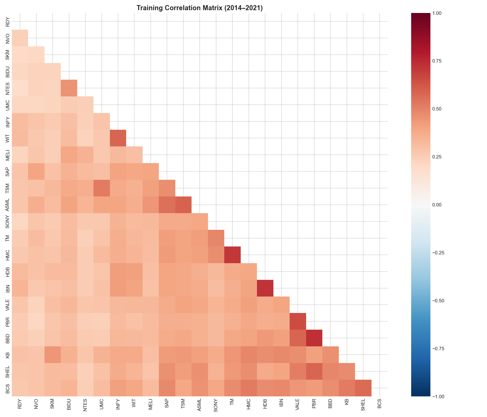
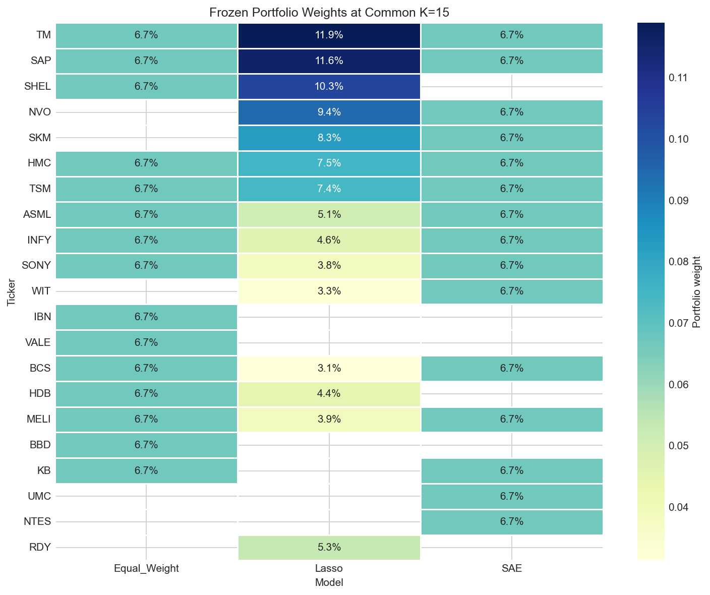
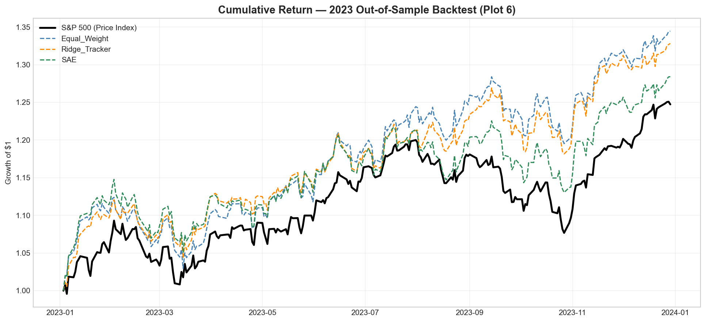
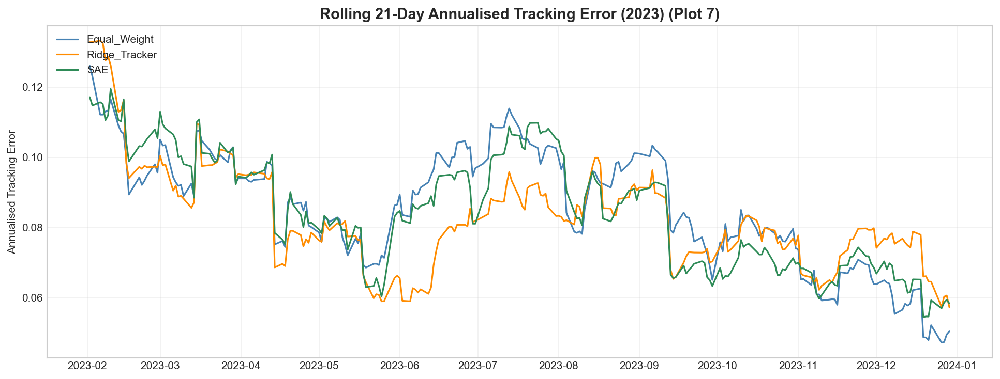

# US-Listed S&P 500 Replication


> **Can a small, constrained portfolio of US-listed securities track the S&P 500 out of sample?**

This project studies index replication using a compact universe of common stocks, ADRs, and foreign ordinary shares traded on US exchanges. It compares transparent portfolio construction methods under practical research constraints rather than attempting to build a live trading system.

The current `research-workflow` branch introduces:

- A versioned security-universe manifest
- Point-in-time exchange and instrument eligibility
- Prior-only trading-history and liquidity screening
- Explicit S&P 500 total-return configuration
- Missing-data handling that avoids blanket forward-filling
- Focused tests for universe and configuration rules

> **Scope:** This is a research-grade project, not an investment product. Data coverage, historical security metadata, index membership, and transaction costs remain simplified assumptions.

---

## Contents

- [Research question](#research-question)
- [Universe and data](#universe-and-data)
- [Portfolio models](#portfolio-models)
- [Evaluation framework](#evaluation-framework)
- [Diagnostics](#diagnostics)
- [Limitations](#limitations)
- [Roadmap](#roadmap)
- [Project structure](#project-structure)

## Research question

The project evaluates whether a small portfolio can reproduce the return behavior of a broad US equity index without directly holding all of its constituents.

The primary research objective is:

> Determine whether an eligible, long-only, fully invested portfolio of US-listed securities can track the S&P 500 Total Return Index out of sample while respecting portfolio-size, liquidity, and concentration constraints.

This is deliberately narrower than claiming that the resulting portfolio is a production-ready substitute for the S&P 500.

## Universe and data

### Eligibility rules

The research universe is defined through [`configs/universe.csv`](configs/universe.csv) and filtered using [`src/universe.py`](src/universe.py).

| Category | Policy |
| --- | --- |
| Exchanges | NYSE, Nasdaq, and NYSE American |
| Eligible instruments | Common stocks, ADRs, and foreign ordinary shares |
| Excluded instruments | ETFs, ETNs, funds, preferred shares, warrants, rights, and structured products |
| Benchmark | S&P 500 Total Return Index (`^SP500TR`) |
| Minimum history | 252 observations |
| Liquidity measure | Trailing median dollar volume |
| Liquidity lookback | 252 observations |
| Minimum median dollar volume | `$5 million` |
| Minimum valid volume history | 80% of the lookback window |

Eligibility is evaluated using information available at the portfolio formation date. Duplicate issuers are rejected by the manifest loader so that one issuer is not unintentionally represented multiple times.

### Data pipeline

The ingestion stage:

1. Loads the versioned universe manifest.
2. Applies point-in-time listing, exchange, instrument, and S&P 500 eligibility rules.
3. Downloads prices and volumes from Yahoo Finance.
4. Applies the prior-only liquidity and history screen.
5. Preserves missing observations instead of filling securities indiscriminately.
6. Computes log returns from observed prices.
7. Saves the selected universe and derived return data for later stages.

### Feature engineering

Training-only scaling is used for the neural model. The linear portfolio models operate on unscaled returns so their weights remain directly interpretable.


## Portfolio models

### 1. Equal-weight baseline

A transparent benchmark that ranks securities by training-period relationship with the target, selects the top candidates, and allocates equal weights.

### 2. Ridge-regularized tracker

A long-only, fully invested convex tracker that minimizes benchmark-return error while penalizing concentrated allocations:

$$
\min_w \left[\operatorname{MSE}(Xw-y) + \lambda \lVert w \rVert_2^2\right]
$$

Subject to:

$$
\sum_i w_i = 1,\qquad w_i \geq 0
$$

### 3. Sparse autoencoder

A nonlinear research model using:

```text
Input returns
    ↓
Noise + dropout
    ↓
Latent representation
    ↓
Tracking head
    ↓
Portfolio weights
```

The autoencoder is treated as an experimental model. It must demonstrate stable out-of-sample value over the simpler linear tracker before it justifies additional complexity.

## Evaluation framework

The project separates estimation, validation, and out-of-sample evaluation:

| Stage | Purpose |
| --- | --- |
| Estimation | Fit portfolio models |
| Validation | Select model parameters and portfolio settings |
| Test | Measure unseen performance |

The configured research direction uses chronological walk-forward folds. The initial workflow retains simplified assumptions around rebalancing and execution so the core replication question can be evaluated before adding live-operations complexity.

### Metrics

The evaluation tracks:

- Annualized tracking error
- Correlation with the benchmark
- Cumulative return difference
- Maximum drawdown
- Residual Sharpe ratio
- Active holdings
- Portfolio concentration
- Turnover and estimated transaction costs as the workflow matures

## Diagnostics

The repository includes visual diagnostics for price histories, missing observations, correlations, regularization sweeps, portfolio weights, cumulative returns, rolling tracking error, residual distributions, and neural-model learning curves.

| Diagnostic | Preview |
| --- | --- |
| Correlation structure |  |
| Portfolio allocations |  |
| Cumulative performance |  |
| Rolling tracking error |  |

## Limitations

This project intentionally stops short of production portfolio management.

- **Historical metadata:** The initial universe manifest is curated and is not an institutional-grade security master.
- **Index membership:** Historical S&P 500 membership data is approximated rather than sourced from a fully institutional point-in-time database.
- **Market data:** Yahoo Finance is suitable for research experimentation but not investment accounting or execution.
- **Survivorship:** Delisted and suspended securities may not be fully represented.
- **Costs:** Transaction costs are simplified estimates and do not model market impact, spreads, taxes, or broker-specific fees.
- **Operations:** The project does not place orders, reconcile accounts, monitor live positions, or provide investment advice.
- **Historical relationships:** Strong backtest performance would not guarantee future tracking quality.

## Roadmap

### Phase 1 — Core research correctness

- Complete the point-in-time universe workflow.
- Make benchmark and price-adjustment conventions explicit.
- Validate missing-data and corporate-action handling.
- Enforce portfolio-size and weight constraints consistently.
- Keep the linear tracker as the primary model.

### Phase 2 — Research maturity

- Run repeated walk-forward evaluations.
- Add rebalancing and turnover accounting.
- Report gross and net-of-cost results.
- Add sensitivity analysis for liquidity, holding count, and cost assumptions.
- Evaluate neural models across controlled random seeds.

### Phase 3 — Optional extensions

- Alternative regularization methods
- Factor and risk-model constraints
- Additional benchmark comparisons
- More detailed execution-cost simulation
- Dynamic retraining and portfolio maintenance

Advanced models and live-trading infrastructure are intentionally deferred until the core research result is reliable.

## Project structure

```text
.
├── configs/
│   ├── main.toml          # Research configuration
│   └── universe.csv       # Versioned security manifest
├── src/
│   ├── data_pipeline.py   # Market-data ingestion and preprocessing
│   ├── universe.py        # Eligibility and liquidity screening
│   ├── features.py        # Splits and training-only scaling
│   ├── models/            # Portfolio construction models
│   ├── backtest.py        # Out-of-sample simulation
│   └── diagnostics.py     # Metrics and plots
├── tests/                 # Configuration, import, seed, and universe tests
├── data/                  # Derived research artifacts
├── models/                # Saved model outputs
└── plots/                 # Diagnostic figures
```

## Disclaimer

This repository is for research and educational purposes only. It is not investment advice, an offer to buy or sell securities, or a guarantee of portfolio performance.
