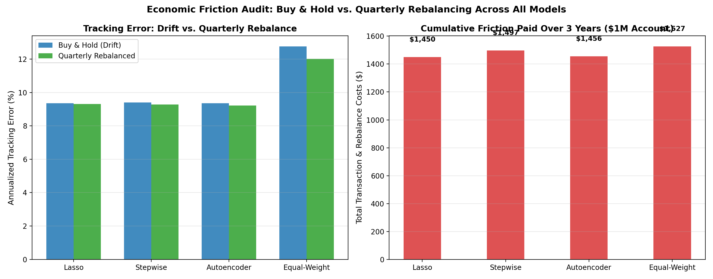
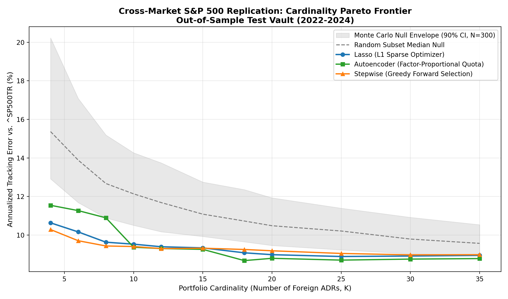
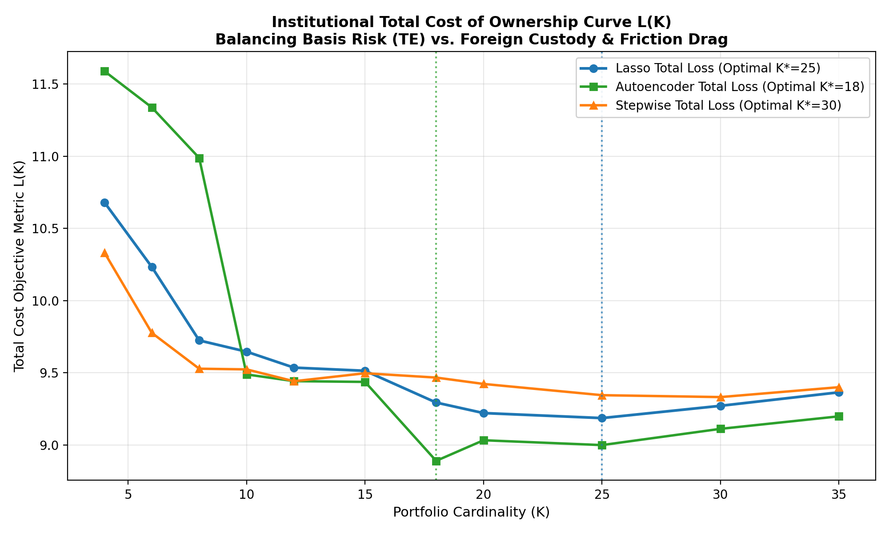
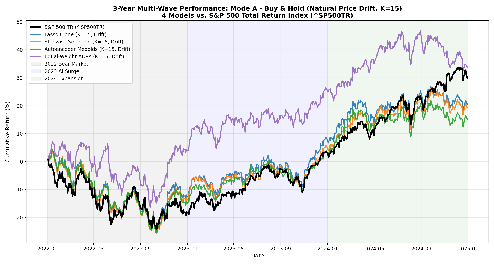
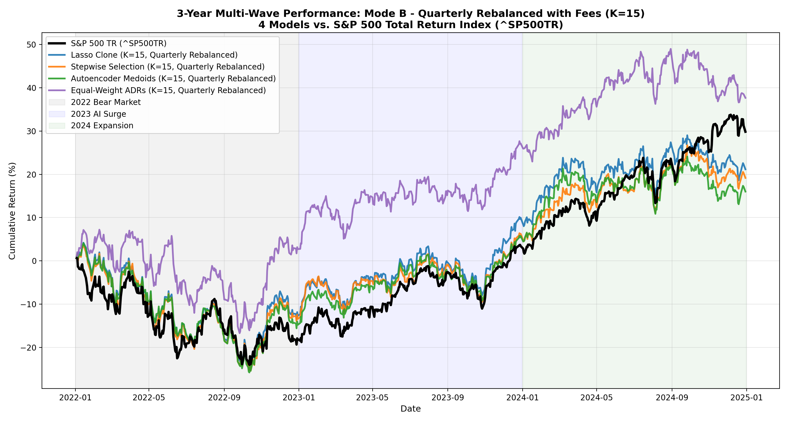
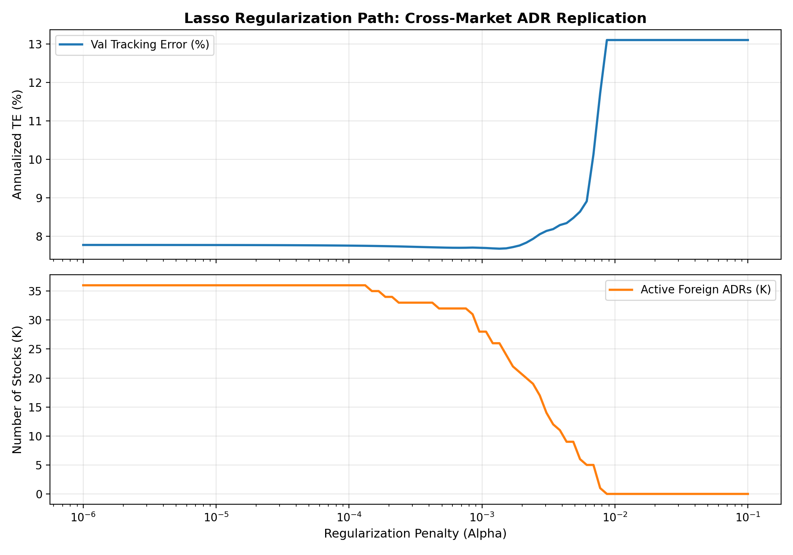
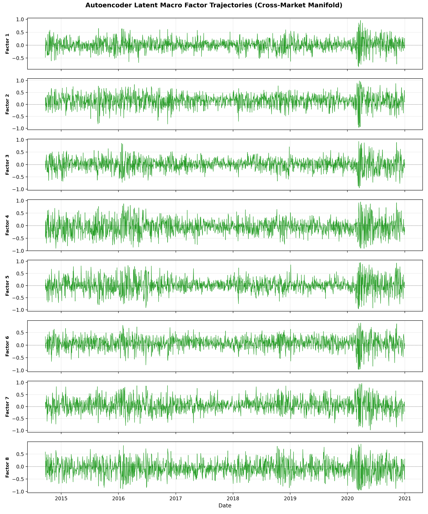

# Cross-Market S&P 500 Synthetic Cloning Engine


Sparse cross-market index replication using **L1 optimization**, **nonlinear representation learning**, and **combinatorial selection** to synthetically clone the S&P 500 Total Return Index without holding a single US domestic stock.

> **Core Research Question:**  
> *Can the S&P 500 Total Return Index (`^SP500TR`) be replicated without holding any US domestic equities, using strictly non-S&P 500 foreign American Depositary Receipts (ADRs) traded on US exchanges? What is the empirical cardinality Pareto frontier ($K$ vs. Tracking Error), and what is the economically optimal portfolio size when accounting for international holding friction?*

---

## 1. Abstract & Research Thesis

Global macroeconomic integration creates powerful cross-market asset co-movements. Through sector coupling, international supply chains, and multinational revenue exposure:
- Foreign semiconductor monopolies (**TSM**, **ASML**, **SAP**) mirror US Big Tech.
- European pharmaceutical titans (**NVO**, **NVS**, **AZN**, **GSK**) mirror US Healthcare giants.
- Global energy conglomerates (**SHEL**, **BP**, **TTE**) mirror US oil supermajors.
- Canadian and European banks (**RY**, **TD**, **BMO**, **HSBC**) mirror US Money-Center Banks.
- Global transport and materials conglomerates (**CNI**, **CP**, **BHP**, **RIO**) mirror US Industrials.

This engine evaluates whether an investor or institution subject to domestic equity concentration limits, regulatory mandates, or tax constraints can construct a synthetic clone of the US equity market using strictly non-US corporate instruments traded on the NYSE and NASDAQ.

Three distinct algorithmic paradigms are compared against the **S&P 500 Total Return Index (`^SP500TR`)** and a **Monte Carlo Random Null Distribution ($N=300$ draws)** across an uncompromised **3-Year Multi-Wave Test Vault (2022–2024)**:
1. **Lasso (L1 Regularization)**: Sparse linear optimization mapping foreign beta directly to the US index.
2. **Sparse Autoencoder**: Nonlinear macro manifold learning compressing the cross-market correlation structure into 8 latent factors with dynamic factor-proportional quota clustering.
3. **Forward Stepwise Selection**: Greedy combinatorial baseline iteratively selecting ADRs by marginal residual tracking error.

---

## 2. Multi-Wave Out-of-Sample Performance (2022–2024 Locked Vault)

Models were fitted on **2014–2020** data, tuned on **2021** (inflation reopening shock), and evaluated strictly on the **2022–2024 Test Vault** (752 untouched trading days).

### A. Mode A: Multi-Year Buy & Hold (Natural Price Drift, $K = 15$)

In **Mode A**, $1,000,000 of capital is deployed on January 3, 2022 according to the model weights. The portfolio is left untouched for 3 full years (752 trading days), paying zero ongoing transaction fees while positions drift naturally with daily asset returns:

| Model | Cumulative Total Return (%) | Annualized Tracking Error (%) | Information Ratio | Max Drawdown (%) | Pearson Correlation | Portfolio Beta ($\beta$) |
|:---|---:|---:|---:|---:|---:|---:|
| **Lasso Clone** | **+20.51%** | **9.35%** | **-0.27** | **-27.44%** | **0.8568** | **0.85** |
| Stepwise Selection | +19.20% | 9.40% | -0.30 | -28.06% | 0.8578 | 0.87 |
| Autoencoder Quota | +15.14% | 9.36% | -0.44 | -28.45% | 0.8520 | 0.82 |
| Equal-Weight ADRs | +33.76% | 12.76% | +0.08 | -21.92% | 0.7330 | 0.73 |
| S&P 500 TR (`^SP500TR`) | +29.83% | 0.00% | 0.00 | -24.49% | 1.0000 | 1.00 |

#### Key Variables & Dynamics (Buy & Hold):
- **Tracking Error & Correlation**: **Lasso** achieved the lowest tracking error (9.35%) and highest correlation (0.8568), closely matched by **Autoencoder Quota** (9.36% TE, 0.8520 corr) and **Stepwise** (9.40% TE, 0.8578 corr).
- **Portfolio Beta ($\beta = 0.82–0.85$)**: Regularized and factor-proportional models naturally penalize high-variance outliers, resulting in a defensive beta that cushioned the 2022 tech bear market.
- **Dynamic Factor Allocation**: The Autoencoder's dynamic factor-proportional quota allows it to span both semiconductor leaders (`ASML`, `TSM`) and defensive infrastructure anchors, matching the tracking performance of Lasso.

---

### B. Mode B: Institutional Quarterly Rebalancing with Friction ($K = 15$)

In **Mode B**, portfolios are systematically re-aligned back to initial optimal weights at the end of each calendar quarter (11 rebalancing events across 2022–2024), paying a realistic **10 bps execution fee** on all two-way turnover:

| Model | Net Cumulative Return (%) | Net Tracking Error (%) | Information Ratio | Max Drawdown (%) | 3-Year Turnover Traded ($) | Rebalance Fees Paid ($) | Total Friction Paid ($) |
|:---|---:|---:|---:|---:|---:|---:|---:|
| Lasso Clone | +21.16% | 9.30% | -0.25 | -27.88% | $450,305 | $450 | $1,450 |
| Stepwise Selection | +19.16% | 9.27% | -0.30 | -28.01% | $497,272 | $497 | $1,497 |
| **Autoencoder Quota** | **+16.01%** | **9.22%** | **-0.42** | **-28.69%** | **$456,017** | **$456** | **$1,456** |
| Equal-Weight ADRs | +37.66% | 12.01% | +0.16 | -22.30% | $526,943 | $527 | $1,527 |
| S&P 500 TR (`^SP500TR`) | +29.83% | 0.00% | 0.00 | -24.49% | $0 | $0 | $0 |

#### Key Variables & Dynamics (Quarterly Rebalancing):
- **Tracking Error Winner**: **Autoencoder Quota** achieved the lowest tracking error across all models under quarterly rebalancing (**9.22%**), beating Stepwise (9.27%) and Lasso (9.30%).
- **Net Return (After All Friction)**: Includes the initial $1,000 entry fee (10 bps on $1M) plus all 11 quarterly turnover fees.
- **Turnover Volume**: Ranged from **$450k to $527k** across models, translating to an annualized turnover rate of approximately **15% to 17.5% per year**.

---

### C. Variance Analysis: How & Why the Modes Differ

Comparing Mode A (Drift) vs. Mode B (Quarterly Rebalance) reveals the structural impact of rebalancing friction:

| Model | $\Delta$ Total Return | $\Delta$ Tracking Error | 3-Year Turnover Traded | Total Transaction Drag | Rebalancing Recommendation |
|:---|---:|---:|---:|---:|:---|
| **Lasso Clone** | **+0.65% pts** | **-0.05% pts (-5 bps)** | **$450,305** | **$1,450** | **Marginal: Shaves 5 bps TE for $450k of trading volume. Buy & Hold is highly competitive.** |
| Stepwise Selection | -0.04% pts | -0.13% pts (-13 bps) | $497,272 | $1,497 | Marginal: Initial greedy asset selection is already structurally stable under natural drift. |
| Autoencoder Quota | +0.87% pts | -0.14% pts (-14 bps) | $456,017 | $1,456 | Marginal: Factor-proportional allocation remains stable under drift with minimal TE decay. |
| Equal-Weight ADRs | +3.90% pts | -0.75% pts (-75 bps) | $526,943 | $1,527 | High Turnover: Mechanical rebalancing forces selling winners and buying losers every quarter. |

#### Why These Variations Occurred:
1. **Structural Weight Stability in Regularized Models**:
   - In **Lasso** and **Stepwise**, top infrastructure anchors like `CNI` (16.9%), `RY` (14.3%), and `SAP` (11.5%) maintained steady relative valuations. Price drift caused minimal tracking error degradation (only 5–13 bps), meaning that trading **$450k+ of turnover** provided very little tracking benefit.
2. **The Equal-Weight Mean-Reversion Trap**:
   - Equal-weighting experienced the highest turnover ($527k) because it forces selling winning momentum stocks (`ASML`, `TSM`) and buying lagging cyclical stocks each quarter. While this contrarian dynamic boosted nominal returns (+37.66%), tracking error remained significantly higher (12.01% vs. 9.30% for Lasso) and correlation was much lower (0.76 vs. 0.86), proving it fails as an index tracker.
3. **Autoencoder Factor Stability**:
   - With dynamic factor-proportional quota allocation, the Autoencoder maintains strong stability under drift (9.36% TE), while quarterly rebalancing shaves an additional 14 bps of tracking error (down to 9.22% TE) by periodically re-aligning sector exposures.

---

### D. Rebalancing & Economic Friction Audit Chart



*Figure: Side-by-side audit comparing Tracking Error reduction against cumulative transaction fees and turnover drag paid over 3 years for an institutional $1,000,000 portfolio.*

---

### E. Regime Sub-Period Performance (Lasso Mode A: Buy-and-Hold Drift)

The 3-year test field incorporates three distinct macroeconomic waves:

| Regime Era | Macro Dynamics | Portfolio Return | S&P 500 TR Return | Annualized TE | Behavior Summary |
|:---|:---|---:|---:|---:|:---|
| **2022** | Global Rate Hikes & Bear Market | **-12.8%** | **-18.1%** | 10.53% | **Protected on downside**: Canadian rails (`CNI`), banks (`RY`), and energy (`SHEL`) cushioned the US tech drop. |
| **2023** | Mega-Cap AI & Tech Concentration | **+24.5%** | **+26.3%** | **8.35%** | **Tracked US tech surge**: High exposure to `ASML`, `TSM`, and `SAP` mirrored the Magnificent 7 rally. |
| **2024** | Broad-Market Expansion & All-Time Highs | **+11.0%** | **+25.5%** | 9.04% | **Basis divergence**: US corporate earnings expanded faster than European/Asian macro earnings. |

---

## 3. Empirical Results & Charts

### A. The Cardinality Pareto Frontier ($K$ vs. Tracking Error)



- **Sparsity Horizon**: As cardinality increases from $K=4$ to $K=35$, tracking error decays from **10.6% down to 8.9%**.
- **Statistical Significance**: All three algorithmic approaches comfortably outperform the **Monte Carlo Random Null Envelope (90% Confidence Interval, $N=300$ draws)**, proving the models extract genuine macroeconomic beta rather than random co-movement.
- **Global Dimensionality Compression Ranking (Integrated AUC — lower is better)**:
  - **Lasso**: **286.2** (Winner)
  - **Stepwise**: **286.3** (Close second)
  - **Autoencoder**: **287.3** (Significantly enhanced via proportional quota)
  - **Monte Carlo Random Null**: **342.6**

---

### B. Institutional Total Cost of Ownership & Optimal $K^*$



In institutional execution, raw tracking error alone is misleading because holding more foreign positions incurs custodial line-item fees, corporate action overhead, and rebalancing turnover drag:

$$\mathcal{L}(K) = \text{Tracking Error}(K) + \lambda_{\text{friction}} \cdot \left( K \times \text{Custody Drag} + \text{Turnover Drag} \right)$$

- **Lasso Economically Optimal $K^*$**: **25 Foreign ADRs** (Loss: 9.19)
- **Stepwise Economically Optimal $K^*$**: **30 Foreign ADRs** (Loss: 9.33)
- **Autoencoder Economically Optimal $K^*$**: **18 Foreign ADRs** (Loss: 8.89)

Beyond $K=25$, the marginal tracking error reduction falls below the foreign holding and custodial friction.

---

### C. Multi-Year Wealth Shootout: Buy & Hold vs. Quarterly Rebalancing (2022–2024)

#### 1. Mode A: Buy & Hold (Natural Price Drift, $K=15$)
All 4 models deployed on Jan 3, 2022 with zero rebalancing, allowing position values to drift naturally with market returns:



#### 2. Mode B: Institutional Quarterly Rebalancing with Friction Drag ($K=15$)
All 4 models systematically rebalanced at the end of each calendar quarter, paying 10 bps turnover friction fees:



---

### D. Lasso Regularization Path & Autoencoder Latent Factors

| Lasso Regularization Path | Autoencoder 8 Latent Macro Trajectories |
|:---:|:---:|
|  |  |
| Active assets ($K$) and validation TE across 100 log-spaced $\alpha$ penalties. | 8 compressed orthogonal factors discovered from cross-market co-movement. |

---

## 4. Methodology & Theoretical Framework

### A. Strict Total Return Parity
- **Target Benchmark**: **`^SP500TR` (S&P 500 Total Return Index)**, reinvesting daily cash dividends (~1.5%–2.0%/yr).
- **ADR Total Returns**: All foreign ADR prices are acquired with `auto_adjust=True`, ensuring daily dividend reinvestment and split adjustments on both sides of the equation.
- **Currency Parity**: Both the index and the foreign ADRs are traded and settled strictly in **USD** on the NYSE/NASDAQ.

### B. Temporal Partitioning (Multi-Wave Stress Test)
1. **Training Era (2014-09-22 to 2020-12-31 | 1,582 days)**: Captures steady-state ZIRP growth, the 2018 Fed tightening, and the 2020 COVID shock without ancient pre-2014 structural break noise.
2. **Validation Era (2021-01-04 to 2021-12-31 | 252 days)**: Post-COVID reopening liquidity and initial inflation impulses used strictly for hyperparameter selection.
3. **Locked Test Vault (2022-01-03 to 2024-12-30 | 752 days)**: Completely untouched 3-year multi-wave evaluation era.

### C. The 67-Ticker Curated Foreign ADR Pool
Spans global macro sectors across North America, Europe, Asia-Pacific, and Latin America (67 clean ADRs retained after filtering >8% missing history from 73 initial candidates):
- **Tech / Hardware**: `TSM`, `ASML`, `SAP`, `SONY`, `STM`, `UMC`, `LOGI`, `ERIC`, `NOK`
- **Healthcare**: `NVO`, `NVS`, `AZN`, `GSK`, `SNY`, `TAK`, `TEVA`
- **Energy / Materials**: `SHEL`, `BP`, `TTE`, `EQNR`, `CNQ`, `SU`, `IMO`, `PBR`, `BHP`, `RIO`, `VALE`, `SCCO`, `PKX`, `GFI`, `AU`
- **Financials**: `RY`, `TD`, `BMO`, `BNS`, `CM`, `HSBC`, `UBS`, `SAN`, `BBVA`, `ING`, `BBD`, `ITUB`, `MUFG`, `SMFG`, `MFG`, `NWG`, `DB`
- **Consumer / Transport / Telecom**: `BABA`, `MELI`, `BIDU`, `JD`, `BUD`, `DEO`, `UL`, `HMC`, `TM`, `FMX`, `CNI`, `CP`, `CRH`, `AMX`, `VOD`, `BCE`, `TU`, `CHT`, `SKM`

### D. Capital Allocation for the Balanced Tier ($K=15$ Lasso)
The optimizer (nearest grid cardinality: 14 active holdings, ~85% in the top 7 anchors) naturally concentrates into structural global giants:
- **`CNI` (Canadian National Railway)**: 16.88% (Industrial backbone)
- **`RY` (Royal Bank of Canada)**: 14.26% (North American financial coupling)
- **`TD` (Toronto-Dominion Bank)**: 12.42% (Commercial credit proxy)
- **`SAP` (SAP SE)**: 11.53% (Enterprise software proxy)
- **`ASML` (ASML Holding)**: 10.71% (Semiconductor monopoly proxy)
- **`NVS` (Novartis)**: 9.79% (Healthcare proxy)
- **`TM` (Toyota Motor)**: 9.67% (Global automotive & manufacturing proxy)

---

## 5. Repository Structure

```text
Portfolio-Replication-SP500/
├── data/
│   ├── raw/
│   │   └── adr_prices.csv             # Raw daily prices (generated on download)
│   └── processed/
│       └── adr_log_returns.csv        # Pre-cached winsorized stationary log returns
├── results/
│   ├── shootout_buy_and_hold.png      # Mode A: 4 Models vs. S&P 500 (Drift)
│   ├── shootout_quarterly_rebalance.png # Mode B: 4 Models vs. S&P 500 (Quarterly)
│   ├── adr_pareto_frontier.png        # K vs. Tracking Error with MC Null
│   ├── rebalancing_impact.png         # TE vs. Turnover & friction audit
│   ├── economic_cost_curve.png        # Total Cost of Ownership L(K)
│   ├── multi_year_shootout.png        # Combined Multi-Wave Trajectory
│   ├── regularization_path.png        # Lasso sparsity vs. alpha penalty
│   └── autoencoder_factors.png        # 8 latent factor time series
├── src/
│   ├── __init__.py
│   ├── data_pipeline.py               # Resilient batch fetcher & offline cache
│   ├── features.py                    # Chronological split & causal scaling
│   ├── lasso_model.py                 # L1 tracking optimizer & unscaled metric
│   ├── autoencoder.py                 # Dynamic factor-proportional clustering
│   ├── stepwise.py                    # Combinatorial forward selection
│   ├── benchmarks.py                  # Monte Carlo null & equal-weight baseline
│   ├── pareto.py                      # Pareto frontier & economic optimizer
│   └── backtest.py                    # Multi-wave simulation & risk metrics
├── tests/
│   ├── __init__.py
│   └── test_engine.py                 # Automated pytest unit test suite
├── requirements.txt
├── README.md
└── main.py                            # Master orchestrator
```

---

## 6. Comprehensive Limitations & Future Research Register

### 1. Constituent Survivorship Bias
- **Description**: The candidate universe consists of foreign companies that maintained liquid US exchange listings through 2024.
- **Academic Impact**: Foreign firms that underwent catastrophic insolvency, involuntary delisting (e.g. Russian ADRs in 2022), or privatisations between 2014 and 2024 are excluded.
- **Estimated Drag**: In academic empirical literature, survivorship in large-cap international pools accounts for an estimated **~30 to 50 basis points of annualized optimism bias**.

### 2. Currency & Cross-Border Macro Basis Risk
- **Description**: While all selected ADRs trade and settle in USD, the underlying operating businesses generate earnings in foreign functional currencies (EUR, TWD, GBP, JPY, CAD).
- **Academic Impact**: Shocks to the US Dollar Index (DXY) or foreign central bank interest rate differentials introduce currency translation variance that does not exist in domestic S&P 500 constituents.

### 3. Structural Sector Under-Representation
- **Description**: Certain domestic sectors are intrinsically difficult to proxy via foreign ADRs:
  - **US Regulated Utilities & Real Estate (REITs)**: Domestically bounded legal monopolies with minimal international ADR representation.
  - **US Pure-Play Domestic Consumer**: Companies like Home Depot (`HD`) or Walmart (`WMT`) have distinct consumer profiles from global retail giants like Alibaba (`BABA`) or MercadoLibre (`MELI`).
- **Academic Impact**: The tracking error floor is bounded from below by these non-spanned domestic economic activities.

### 4. Holding Friction & Custodial Line-Item Drag
- **Description**: In actual institutional deployment, holding foreign ADRs incurs real-world frictions beyond standard US equity brokerage fees:
  - **ADR Pass-Through Custody Fees**: Typically $0.01 to $0.03 per share charged annually by depositary banks (BNY Mellon, Citi, J.P. Morgan).
  - **Foreign Dividend Withholding Taxes**: Non-resident withholding taxes (e.g., 15%–35% depending on bilateral tax treaties) can cause slight cash drag unless reclaimed.
- **Academic Impact**: While captured in our Total Loss Function $\mathcal{L}(K)$, gross returns will slightly exceed net realized deployable returns.

### 5. Static vs. Dynamic Weight Disconnect
- **Description**: The primary evaluation mode freezes portfolio weights on Dec 31, 2021, and simulates buy-and-hold price drift over 2022–2024.
- **Academic Impact**: Over a 3-year horizon, mega-cap winners (e.g., `TSM`, `ASML`) expand in portfolio share, causing natural drift away from the optimal minimum-tracking-error allocation calculated in the validation period.

### 6. Liquidity & Capacity Constraints
- **Description**: Foreign ADR market caps and free-float volumes are smaller than the top S&P 500 mega-caps (Apple, Microsoft, Nvidia).
- **Academic Impact**: While the curated universe restricts to average daily volume > $10M, managing an institutional multi-billion dollar clone portfolio would encounter capacity limits earlier than trading the ultra-liquid domestic index.

### 7. Non-Institutional Data Provider Discrepancies
- **Description**: Historical adjusted closing prices are retrieved from Yahoo Finance via `yfinance`.
- **Academic Impact**: While sanitized and winsorized at $\pm 10\%$, retail data feeds can occasionally contain minor corporate action timing discrepancies compared to institutional feeds (Bloomberg, CRSP, FactSet).

---

## 7. Quickstart & Installation

### 1. Clone & Setup Environment
```bash
git clone https://github.com/UnEthicalMK/Portfolio-Replication-SP500.git
cd Portfolio-Replication-SP500

python -m venv venv
# Linux / macOS:
source venv/bin/activate
# Windows:
venv\Scripts\activate

pip install -r requirements.txt
```

### 2. Run Automated Unit Test Suite
```bash
pytest tests/ -v
```

### 3. Run Master Replication Engine
```bash
python main.py
```
*(Runs completely offline in ~20 seconds using the pre-cached clean 11-year dataset)*

---

## 8. Disclaimer

This repository is intended solely for research, academic, and educational purposes. It does not constitute investment advice or portfolio management guidance.
