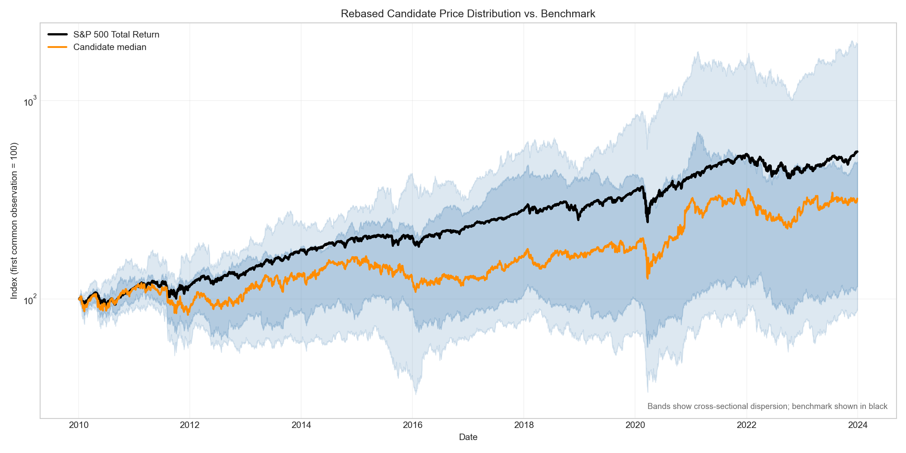
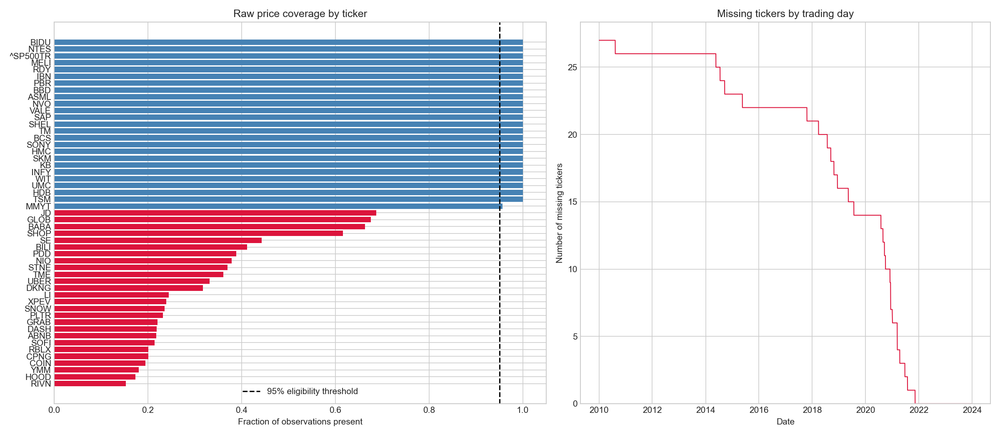
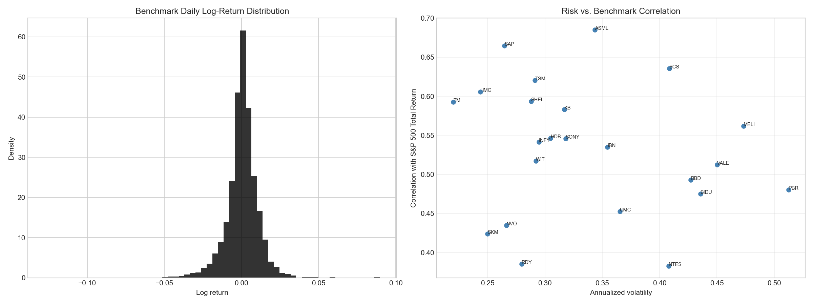
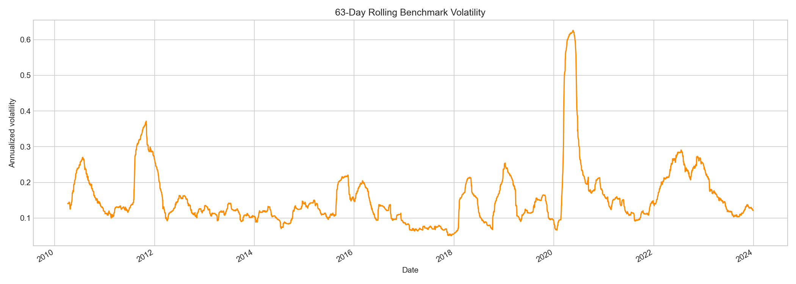
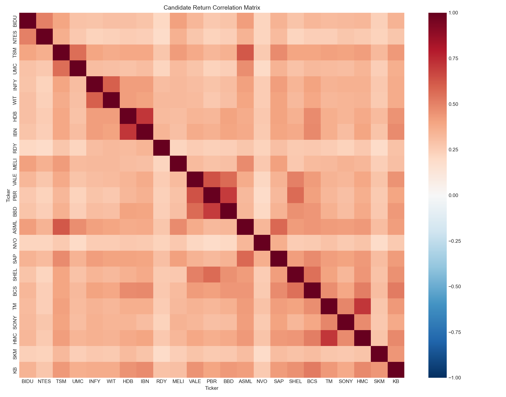

# S&P 500 Replication Prototype

This project evaluates whether a long-only portfolio of US-listed securities
that are not intended to be S&P 500 constituents can statistically track the
S&P 500 Total Return Index out of sample.

## Run locally

Install the dependencies and run the pipeline stages in order:

```powershell
python -m pip install -r requirements.txt
python main.py --all
```

The pipeline downloads the versioned candidate universe, applies explicit
pre-validation coverage rules, creates log returns, trains the portfolio
models, runs the 2023 backtest, and writes diagnostics to `data/` and `plots/`.
Data acquisition starts on 2010-01-01. Detailed output from every stage is
saved to a timestamped file under `logs/`; the terminal displays only stage
operations and completion status.

## Quantitative EDA

The data stage produces:

- [Universe coverage manifest](data/universe_manifest.csv)











The EDA is deliberately separated into data quality, cross-sectional risk,
time-varying benchmark risk, and candidate-correlation views. Plot 1 uses
cross-sectional percentile bands rather than a spaghetti chart.

The universe is intentionally a candidate manifest, not proof of point-in-time
index exclusion. Constituency must be verified with dated constituent data
before interpreting results as a strict non-S&P 500 study.

## Common portfolio size and rebalancing

The portfolio size is selected from `K_GRID` in
[`src/config.py`](src/config.py), not hardcoded to one model. For every
candidate K, the simplex optimizer, equal-weight baseline, and sparse
autoencoder are trained using that exact K. The common K minimizing mean
validation tracking error across all models is then frozen before the test
period. The validation score and candidate K values are saved in
`data/k_selection_validation.csv`.

The 2023 test period reports three execution policies:

- `buy_hold`: initial allocation only, no subsequent trades.
- `walk_forward_monthly`: retrain and rebalance at the first available trading
  day of each month.
- `walk_forward_quarterly`: retrain and rebalance at the first available
  trading day of each quarter.

Each rebalance applies security-specific transaction costs to traded value.
The test period does not select K or model parameters.
Results are saved in `data/oos_portfolio_returns.csv`, with columns named
`<model>__<strategy>`, and turnover is saved in `data/oos_turnover.csv`.

Both walk-forward policies retrain using expanding histories strictly before
each rebalance date. The most recent 63 observations form each window's
validation period, while the common K selected by the initial validation sweep
is held fixed across models. This prevents look-ahead leakage.

Final metrics are reported for every execution strategy and explicitly include
the shared portfolio size `K` used by all three models. The adaptive walk-forward rows use the same common K but date-specific holdings.
The readable report is saved to
[`data/final_summary_metrics.md`](data/final_summary_metrics.md). A
machine-readable CSV is also saved to
[`data/final_summary_metrics.csv`](data/final_summary_metrics.csv). The
terminal only reports completed operations rather than printing the full report.

The main research figures are:

- [Common K selection](plots/04_k_selection.png)
- [Frozen model weights](plots/05_instrument_weights.png)
- [Out-of-sample performance by policy](plots/06_oos_performance.png)
- [Rolling tracking error by policy](plots/07_oos_tracking_error.png)
- [Test-period turnover](plots/09_turnover.png)
- [Buy-and-hold residual distributions](plots/08_residual_distribution.png)

Plots 6 and 7 show net-of-cost portfolio values and tracking error for buy and
hold, walk-forward monthly, and walk-forward quarterly policies. Initial
purchases and every scheduled rebalance include the security-specific friction
assumptions.

Plot 5 is only the final frozen portfolio at the selected common K; it is not a
plot of all K values. Plot 4 shows the full K grid, each model's minimum
validation TE, and the common K chosen by mean TE. Plot 9 reports cumulative
traded notional divided by initial portfolio value: it answers how much capital
was traded, not whether a strategy performed well. Plot 11 is a benchmark
volatility-regime diagnostic for interpreting periods of elevated tracking
error, not a model-performance result.
The date-specific allocations are also saved in
`data/walk_forward_weights.csv`, allowing holdings overlap and weight-distance
diagnostics to be computed directly.

## Highest-value robustness diagnostics

Run the additional research diagnostics with:

```powershell
python main.py --research-analysis
```

The GitHub-readable combined report is
[`data/research_analysis.md`](data/research_analysis.md). The individual CSV
files listed below remain available for programmatic analysis.

The stage produces:

- `data/rolling_market_diagnostics.csv` and
  `plots/13_rolling_market_exposure.png`: rolling correlation, beta, and
  tracking error against the benchmark.
- `data/factor_exposures.csv`: regression exposures to the benchmark and
  transparent candidate-universe momentum and low-volatility proxy factors.
  These are descriptive proxies, not claims of point-in-time academic factor
  purity.
- `data/regime_metrics.csv`: performance in high/low-volatility and up/down
  market regimes.
- `data/sensitivity_summary.csv`: validation sensitivity across the K grid and
  cumulative turnover by execution policy.
- `data/oos_cost_attribution.csv`: gross return, net return, and explicit
  transaction-cost drag for each strategy and model.

Transaction costs are included in the net portfolio values and are now
separately attributed against gross portfolio returns.

Plot 8 includes dashed normal-density fits as a diagnostic reference. They are
not an assumption that residuals are Gaussian; deviations from the overlays
are part of the tail-risk analysis.

## Return convention

Price changes are stored as continuous log returns:

```text
log(price_t) - log(price_{t-1})
```

Cumulative performance is therefore calculated as
`exp(sum(log_returns)) - 1`.

## Interpretation limits

This is a research prototype, not an investment product. The current workflow
does not yet provide point-in-time constituent data or a full liquidity and
execution model. Results should be
treated as statistical tracking evidence rather than proof that the portfolio
is a live substitute for the S&P 500.
