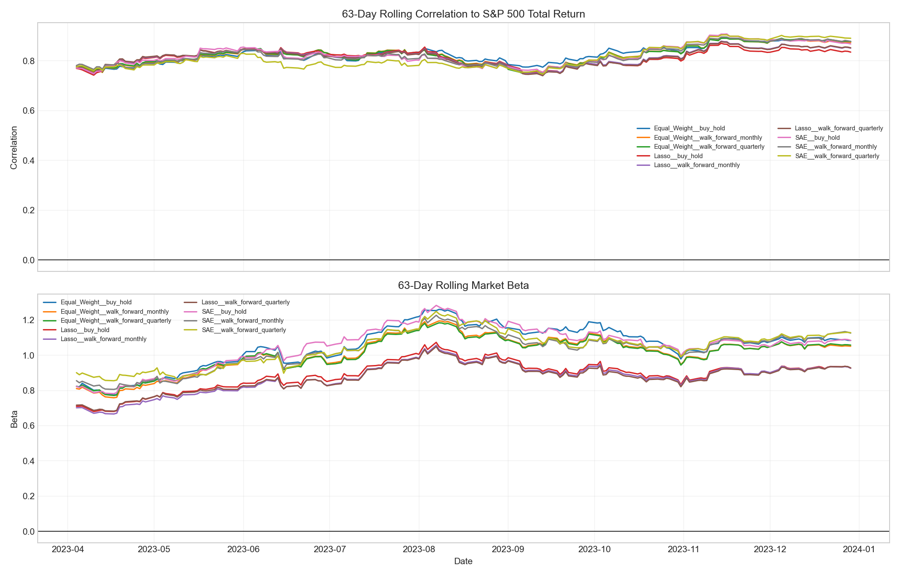

# Research Robustness Diagnostics

These diagnostics are descriptive research outputs, not investment recommendations. CSV files are retained beside this report for analysis.

## Rolling market exposure

The 63-day rolling correlation and beta plot shows whether portfolio similarity to the benchmark is stable across market conditions.

Data: [`rolling_market_diagnostics.csv`](rolling_market_diagnostics.csv)

## Proxy-factor exposures

These regressions use candidate-universe proxy factors. Momentum and low-volatility factors are descriptive and are not point-in-time academic factor portfolios.

| Strategy | Alpha (daily) | Market Beta | Momentum Beta | LowVol Beta | R-squared | Observations |
| --- | --- | --- | --- | --- | --- | --- |
| Equal_Weight__buy_hold | 0.0001 | 0.8864 | -0.0848 | -0.1981 | 0.6913 | 249 |
| Lasso__buy_hold | 0.0004 | 0.8325 | 0.0251 | 0.0143 | 0.6321 | 249 |
| SAE__buy_hold | 0.0002 | 0.8899 | -0.0510 | -0.1957 | 0.6743 | 249 |
| Equal_Weight__walk_forward_monthly | 0.0001 | 0.8857 | -0.1358 | -0.1155 | 0.6772 | 249 |
| Lasso__walk_forward_monthly | 0.0004 | 0.8272 | -0.0019 | 0.0275 | 0.6386 | 249 |
| SAE__walk_forward_monthly | 0.0003 | 0.8981 | -0.0931 | -0.1755 | 0.6796 | 249 |
| Equal_Weight__walk_forward_quarterly | 0.0001 | 0.8887 | -0.1303 | -0.1172 | 0.6783 | 249 |
| Lasso__walk_forward_quarterly | 0.0004 | 0.8302 | 0.0006 | 0.0254 | 0.6393 | 249 |
| SAE__walk_forward_quarterly | 0.0002 | 0.9101 | -0.1013 | -0.1978 | 0.6811 | 249 |

Data: [`factor_exposures.csv`](factor_exposures.csv)

## Regime analysis

| Strategy | Regime | Observations | Cumulative Return | Tracking Error | Correlation |
| --- | --- | --- | --- | --- | --- |
| Equal_Weight__buy_hold | Low volatility | 140 | 8.61% | 8.30% | 82.92% |
| Equal_Weight__buy_hold | High volatility | 47 | 6.76% | 8.42% | 85.51% |
| Equal_Weight__buy_hold | Down market | 112 | -49.24% | 9.60% | 60.89% |
| Equal_Weight__buy_hold | Up market | 137 | 153.33% | 9.04% | 67.21% |
| Lasso__buy_hold | Low volatility | 140 | 12.47% | 7.83% | 79.98% |
| Lasso__buy_hold | High volatility | 47 | 5.26% | 6.94% | 85.57% |
| Lasso__buy_hold | Down market | 112 | -41.78% | 9.13% | 57.15% |
| Lasso__buy_hold | Up market | 137 | 129.80% | 7.83% | 66.19% |
| SAE__buy_hold | Low volatility | 140 | 9.70% | 8.70% | 81.54% |
| SAE__buy_hold | High volatility | 47 | 5.18% | 8.57% | 85.39% |
| SAE__buy_hold | Down market | 112 | -48.98% | 10.10% | 58.80% |
| SAE__buy_hold | Up market | 137 | 159.20% | 9.08% | 66.27% |
| Equal_Weight__walk_forward_monthly | Low volatility | 140 | 10.08% | 8.22% | 81.78% |
| Equal_Weight__walk_forward_monthly | High volatility | 47 | 5.03% | 7.68% | 86.68% |
| Equal_Weight__walk_forward_monthly | Down market | 112 | -48.22% | 9.43% | 61.13% |
| Equal_Weight__walk_forward_monthly | Up market | 137 | 146.40% | 8.74% | 66.13% |
| Lasso__walk_forward_monthly | Low volatility | 140 | 13.54% | 7.61% | 80.60% |
| Lasso__walk_forward_monthly | High volatility | 47 | 5.40% | 6.96% | 85.30% |
| Lasso__walk_forward_monthly | Down market | 112 | -41.02% | 8.95% | 57.35% |
| Lasso__walk_forward_monthly | Up market | 137 | 129.82% | 7.64% | 66.87% |
| SAE__walk_forward_monthly | Low volatility | 140 | 10.40% | 8.50% | 81.75% |
| SAE__walk_forward_monthly | High volatility | 47 | 3.98% | 8.44% | 85.01% |
| SAE__walk_forward_monthly | Down market | 112 | -48.60% | 9.64% | 61.60% |
| SAE__walk_forward_monthly | Up market | 137 | 163.14% | 9.27% | 64.70% |
| Equal_Weight__walk_forward_quarterly | Low volatility | 140 | 10.07% | 8.20% | 81.88% |
| Equal_Weight__walk_forward_quarterly | High volatility | 47 | 4.81% | 7.62% | 86.63% |
| Equal_Weight__walk_forward_quarterly | Down market | 112 | -48.27% | 9.39% | 61.76% |
| Equal_Weight__walk_forward_quarterly | Up market | 137 | 146.13% | 8.75% | 66.28% |
| Lasso__walk_forward_quarterly | Low volatility | 140 | 13.50% | 7.62% | 80.52% |
| Lasso__walk_forward_quarterly | High volatility | 47 | 5.11% | 6.99% | 85.08% |
| Lasso__walk_forward_quarterly | Down market | 112 | -41.18% | 8.96% | 57.79% |
| Lasso__walk_forward_quarterly | Up market | 137 | 129.43% | 7.65% | 67.04% |
| SAE__walk_forward_quarterly | Low volatility | 140 | 9.40% | 8.37% | 82.84% |
| SAE__walk_forward_quarterly | High volatility | 47 | 4.05% | 9.36% | 81.46% |
| SAE__walk_forward_quarterly | Down market | 112 | -50.06% | 9.81% | 61.95% |
| SAE__walk_forward_quarterly | Up market | 137 | 165.06% | 9.67% | 63.67% |

Data: [`regime_metrics.csv`](regime_metrics.csv)

## Gross versus net cost attribution

| Strategy | Model | Gross Return | Net Return | Transaction Costs | Transaction Cost (bps) |
| --- | --- | --- | --- | --- | --- |
| buy_hold | Equal_Weight | 28.59% | 28.43% | 1266.6667 | 12.6667 |
| buy_hold | Lasso | 33.79% | 33.63% | 1186.2081 | 11.8621 |
| buy_hold | SAE | 32.24% | 32.08% | 1266.6559 | 12.6666 |
| walk_forward_monthly | Equal_Weight | 27.43% | 27.43% | 2092.1726 | 20.9217 |
| walk_forward_monthly | Lasso | 35.40% | 35.39% | 2002.5264 | 20.0253 |
| walk_forward_monthly | SAE | 35.13% | 35.07% | 6761.4184 | 67.6142 |
| walk_forward_quarterly | Equal_Weight | 27.17% | 27.15% | 1661.8950 | 16.6190 |
| walk_forward_quarterly | Lasso | 34.81% | 34.80% | 1547.7515 | 15.4775 |
| walk_forward_quarterly | SAE | 32.24% | 32.20% | 2472.4305 | 24.7243 |

Data: [`oos_cost_attribution.csv`](oos_cost_attribution.csv)

## Sensitivity

| Sensitivity | Parameter | Model | Validation Tracking Error | Cumulative Turnover |
| --- | --- | --- | --- | --- |
| K | 5 | Lasso | 14.20% | — |
| K | 5 | Equal_Weight | 17.50% | — |
| K | 5 | SAE | 14.88% | — |
| K | 10 | Lasso | 11.92% | — |
| K | 10 | Equal_Weight | 14.48% | — |
| K | 10 | SAE | 13.60% | — |
| K | 15 | Lasso | 10.92% | — |
| K | 15 | Equal_Weight | 12.83% | — |
| K | 15 | SAE | 12.72% | — |
| K | 20 | Lasso | 11.23% | — |
| K | 20 | Equal_Weight | 12.91% | — |
| K | 20 | SAE | 12.87% | — |
| Execution policy | walk_forward_monthly | Equal_Weight | — | 1.5731 |
| Execution policy | walk_forward_monthly | Lasso | — | 1.5718 |
| Execution policy | walk_forward_monthly | SAE | — | 4.3182 |
| Execution policy | walk_forward_quarterly | Equal_Weight | — | 1.2702 |
| Execution policy | walk_forward_quarterly | Lasso | — | 1.2425 |
| Execution policy | walk_forward_quarterly | SAE | — | 1.7451 |

Data: [`sensitivity_summary.csv`](sensitivity_summary.csv)

Interpretation: K sensitivity is measured on the validation period; turnover sensitivity is measured over the 2023 test period. Neither table should be interpreted as a guarantee of future performance.
